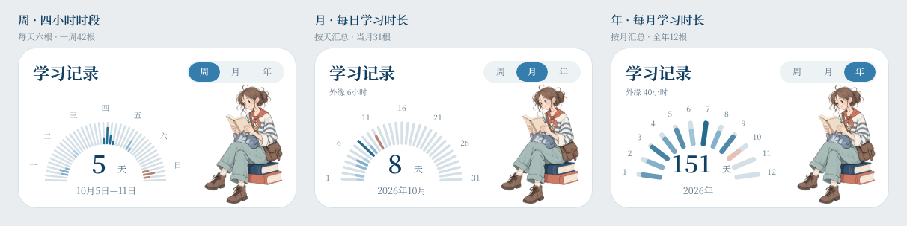

# 学习记录人物表盘调研与三案

2026-10-11。作者希望在前一轮柱状/圆环/圆点/折线探索之上，参考所提供的橘色半圆刻度＋右侧人物卡片，进一步改善观感。初始三案保留如下；后续已按作者确认在A版落实六时段柱、少女与猫人物以及月年汇总半环，最新状态见文末。正式默认样式及业务UI尚未验收。

## 可借鉴的案例

| 来源 | 本轮观察与借鉴 | 在本项目中的处理 |
| --- | --- | --- |
| [Xeropan 官方课堂页](https://xeropan.com/classroom/)及其[官方界面插图](https://xeropan.com/images/bento-grid/b2c/section5.webp) | 人物、统计和行动入口组成同一张卡，插画让数值区更有亲和力 | 采用左侧统计、右侧阅读人物；沿用本项目海蓝/暖橘，而非复制角色或百分比 |
| [Apple Activity Rings](https://www.apple.com/watch/close-your-rings/) | 圆角端点、环形轮廓和颜色层级有辨识度；原产品的环与每日目标相连 | 只借鉴形状与层次；七段对应七个日期，不引入目标完成率 |
| [Finch 官方介绍](https://finchcare.com/about-finch) | 以角色陪伴形成温暖的产品观感 | 采用安静阅读的原创人物，不引入养成、奖励或打卡惩罚 |

以上是界面观察与设计建议，不据这些案例推断学习效果，也不将案例功能自动纳入Nautilus。

## 三版设计

- **A · 刻度半环**：浅海蓝底，49根细圆角刻度按七天分组，星期沿外侧排列。最接近作者参考图，也与当前蓝色按钮协调；本轮优先推荐继续细化这一版。
- **B · 七日弧线**：浅暖橘底，七个日期圆点沿弧线排列；视觉更轻松，刻度密度更低。
- **C · 七日圆环**：暖白底，七段圆角环，中央显示学习天数；轮廓完整、结构紧凑，但比A更像传统统计组件。

三版使用同一组纯示例活动数据`[2,1,0,3,1,0,2]`，汇总为5个有学习的日期。颜色深浅是可视化探索，不据此确认正式计数/强度规则；星期日沿用暖橘强调。没有连续填满的目标进度或掌握百分比。周/月/年入口保留外观，本轮三版为静态周视图，未复制原稿的跨板跳转。

卡片为372×216。整页均为412×915，从最新周主稿复制：本轮读取到其学习记录/今日/并排卡已较上次预览下移31px，原稿保持。新方案保留顶部y55，学习记录加高20px，下方两层相应下移20px，底部导航仍y831/h84。原周/月/年稿、旧四种图形探索和既有切换保留。

整页预览：[A](../superpowers/prototypes/home-material3/home-learning-records-dial-a-20261011.png) · [B](../superpowers/prototypes/home-material3/home-learning-records-dial-b-20261011.png) · [C](../superpowers/prototypes/home-material3/home-learning-records-dial-c-20261011.png)。

## 可编辑稿与素材

共享Penpot文件`New File 2`（`52a5041f-08a1-80f1-8008-c26eb9cfe134`），页面`首页 · Material 3`（`41874d1e-9f7d-8085-8008-c26f76ebe3f5`）。三案对照板`181e4f55-59e1-80b4-8008-c618e20d491e`位于x2404/y1650，1212×304；完整首页位于y2110：

| 方案 | 首页画板 | 学习记录卡片 |
| --- | --- | --- |
| A | `181e4f55-59e1-80b4-8008-c618dc75f1ec` | `181e4f55-59e1-80b4-8008-c618dc75f1f7` |
| B | `181e4f55-59e1-80b4-8008-c618de2f0f74` | `181e4f55-59e1-80b4-8008-c618de2f0f7f` |
| C | `181e4f55-59e1-80b4-8008-c618e01c50b0` | `181e4f55-59e1-80b4-8008-c618e01c50bb` |

图表、文字、卡片均为Penpot原生对象。仅人物使用一次内置`image_gen`生成，三个方案复用同一素材：[1024×1536透明PNG](../superpowers/prototypes/home-material3/assets/learning-reader-20261011.png)、[完整提示词](../superpowers/prototypes/home-material3/assets/learning-reader-20261011-prompt.txt)。原始alpha保留，未后处理位图；按108×162等比放置，人物朝向左侧统计区。未使用CLI生图。

已核对原周主稿编辑前后快照一致；Penpot结构校验0错误，三版静态稿交互数均0。对照板与三张完整首页均原生导出并目视检查；尺寸正确，三张首页底部84px与上一轮已保存导航RGB逐像素一致。未改业务代码、学习记录、数据库或试用服务。

下一项：作者比较三版，选定或提出组合偏好后继续细化；月/年对应图形和正式统计口径仍待确认。

## 后续修订：少女、猫与六根时段柱

作者指定本人提供的角色设定图作为身份来源，原人物仅保留坐姿/读书姿势。新增[透明素材](../superpowers/prototypes/home-material3/assets/adventurer-reader-cat-20261011.png)、[提示词及参考角色](../superpowers/prototypes/home-material3/assets/adventurer-reader-cat-20261011-prompt.txt)和[原三视图副本](../superpowers/prototypes/home-material3/assets/adventurer-cat-turnaround-reference.png)。使用一次内置image_gen编辑；生成PNG为1024×1536 RGBA，alpha保留，未做位图后处理。

图表修订已明确的方向是：每个日期六根条，四小时一根，柱从内向外增长；每天用当前图中日期的学习总时长作相对颜色比较，第一份数据最浅，今天使用同等强度的暖红色。前一版每日期七根仅是装饰刻度，没有七个时段或七次学习的语义。

作者已明确确认：六柱固定对应00–04/04–08/08–12/12–16/16–20/20–24，每柱长度为该时段学习分钟数/240，颜色由当日总时长决定。色阶仅以当前图中有学习数据的日期作min/max比较，单日期或全部相等时取最浅，无学习为中性底色；蓝/暖红共用同一归一化数值与明度曲线，只有色相不同。今天暖红随日期移动，不固定在星期日。以上语义不再是待确认方案。

作者重启客户端后，本轮第二次读取恢复连接；已替换三张完整首页及三张对照卡共六处人物，并在A首页与对照卡落实42根时段柱。B/C图形保留，仅同步新人物。旧图片保留为历史版本。

### 当前修订预览与绘制数据

[完整首页](../superpowers/prototypes/home-material3/home-learning-records-six-slots-20261011.png) · [三案人物同步对照](../superpowers/prototypes/home-material3/learning-records-character-dials-v2-20261011.png)。

下面全部为合成设计数据，单位分钟。各日期分别六条，中性轨道表示四小时的完整尺度；有学习的柱从内侧按分钟数/240增长，零分钟不绘制活动柱。没有把所有时段绘成同长度的装饰刻度。

| 日期 | 00–04 | 04–08 | 08–12 | 12–16 | 16–20 | 20–24 | 当日合计 |
| --- | ---: | ---: | ---: | ---: | ---: | ---: | ---: |
| 周一 | 0 | 0 | 60 | 90 | 30 | 0 | 180 |
| 周二 | 0 | 0 | 0 | 30 | 60 | 0 | 90 |
| 周三 | 0 | 0 | 0 | 0 | 0 | 0 | 0 |
| 周四 | 0 | 0 | 60 | 180 | 90 | 30 | 360 |
| 周五 | 0 | 0 | 0 | 0 | 120 | 30 | 150 |
| 周六 | 0 | 0 | 0 | 0 | 0 | 0 | 0 |
| 周日（示例今天） | 0 | 0 | 60 | 120 | 60 | 0 | 240 |

合计5个有学习日期、1020分钟（17小时）。色阶归一化值为`(当日合计−非零最小值)/(非零最大值−非零最小值)`；仅一个值或最大最小相等时取0，无学习不参与计算且用中性底色。实际数据与日期驱动尚未接入，这些不是本人的记录。

本次视觉映射使用两组OKLCH颜色，共用`L=0.84−0.34t`、`C=0.045+0.045t`，蓝色相235°、暖红色相35°。两组在同一`t`下明度与彩度一致；单值/同值的最浅色为蓝`#AFD0E4`与暖红`#E6C1B7`。样例每日活动色依次为`#82ADC7`、`#AFD0E4`、中性、`#236B8F`、`#91B9D1`、中性、`#B68073`。圆角柱完整尺度28px，实际长度为28×分钟数/240；这些像素和具体色值是当前试稿参数，不扩展为业务统计规则。

A首页新图表为`a248b659-837f-80b9-8008-c629b0b678e3`，对照图表为`a248b659-837f-80b9-8008-c629b177a809`；卡片与首页身份不变。为容纳径向柱向内延伸，中心数字缩至34px并下移，其他卡片/导航保持。两张图均实际核对42条刻度底、每日期6条；共六处新人物，旧人物0；非目标节点属性快照0变化、结构校验0错误。三个PNG尺寸及目视检查通过，整页y280以下（含底栏）与原A首页RGB逐像素一致。已保存命名版本“学习记录 · 少女与猫及六时段柱 · 2026-10-11”。

下一项为作者审阅此版观感；本轮不新增真实学习时长采集、业务UI或月年图形。

### 作者后续手调基线

作者指定继续基于A稿，已将记录卡改为纯白、日期移到表盘下方并删去说明文字；B/C完整首页及对照卡已删，保留A。最新[手调首页预览](../superpowers/prototypes/home-material3/home-learning-records-owner-adjusted-20261011.png)已读取并保存，前面的三案图片均为历史。随后作者已批准月/年表达并要求绘制，实施如下；此前读取与保存并未回改作者画布。

## 周、月、年半环扩展（已批准并完成设计稿）

单卡：[月](../superpowers/prototypes/home-material3/learning-records-month-dial-card-20261011.png)、[年](../superpowers/prototypes/home-material3/learning-records-year-dial-card-20261011.png)。整页：[月首页](../superpowers/prototypes/home-material3/home-learning-records-month-dial-20261011.png)、[年首页](../superpowers/prototypes/home-material3/home-learning-records-year-dial-20261011.png)。

月一日一柱，本例31根；年一月一柱，共12根。两者都保留半环、人物、白底与底部日期，外缘短标尺分别为6小时和40小时。月标签选取1/6/11/16/21/26/31避免拥挤，年标1–12；具体字号/标注间隔是本轮视觉试稿参数。年中心三位数改为32px并加宽，周稿视觉不变。月年长度均为28px×该桶学习时长/本范围最大时长，内外半径52/80；月柱宽3.4px、年柱宽6.6px。颜色继续使用此前共同明度/彩度的蓝/暖红映射，另按正值min-max归一化，不能用颜色归一化值代替柱长比例。

数据全部为合成样例。10月1–4日为90/120/0/150分钟，5–11日直接对应周稿180/90/0/360/150/0/240分钟，12–31日尚未发生，以null保留、仅显示中性轨道。月合计1380分钟=23小时、8个有学习的日期；今天11日为暖红。月最大学习日为360分钟，所以外缘6小时。

| 月份 | 示例总时长（小时） | 示例有学习天数 |
| --- | ---: | ---: |
| 1 | 32 | 16 |
| 2 | 28 | 14 |
| 3 | 36 | 18 |
| 4 | 30 | 15 |
| 5 | 34 | 17 |
| 6 | 25 | 12 |
| 7 | 40 | 20 |
| 8 | 28 | 14 |
| 9 | 35 | 17 |
| 10（当前月） | 23 | 8 |
| 11–12（未来） | 尚无数据 | 不计入 |

年合计311小时、151个有学习的日期，10月完全对应月稿的23小时/8天；7月最高40小时作为外缘，当前10月为暖红。未来月份只有中性轨道，不伪造学习数据或推算整月。实际业务记录与时长采集尚未接入。

| 状态 | 完整首页ID | 记录卡ID | 图表ID |
| --- | --- | --- | --- |
| 周 | `181e4f55-59e1-80b4-8008-c618dc75f1ec` | `181e4f55-59e1-80b4-8008-c618dc75f1f7` | `a248b659-837f-80b9-8008-c629b0b678e3` |
| 月 | `a248b659-837f-80b9-8008-c62e3c521d87` | `a248b659-837f-80b9-8008-c62e3c521d92` | `a248b659-837f-80b9-8008-c62e9b5b634f` |
| 年 | `a248b659-837f-80b9-8008-c62e3c98b35a` | `a248b659-837f-80b9-8008-c62e3c98b365` | `a248b659-837f-80b9-8008-c62e9c94812c` |

三页均412×915，位于x2404/2856/3308、y2110。对照继续使用`181e4f55-59e1-80b4-8008-c618e20d491e`（1212×304），现名“学习记录 / 周月年 · 人物半环对照”；原旧A对照卡替换为作者最新白底周卡，加月年卡，未恢复删除的B/C形态。三张完整首页分别向另外两张绑定click/navigate-to，共6条；当前周期仅呈选中，无自跳转。对照卡无交互。命名版本“学习记录 · 周月年人物表盘 · 2026-10-11”已保存。

检查通过：实际42/31/12条刻度底，三页各唯一选中项及6个真实目的地正确；从周图原生路径名称读取的逐日分钟与月稿对应日期一致，月总量与年10月一致，年学习天数求和151；周视觉属性快照保持，结构校验0错误。5个PNG尺寸及目视通过，月/年整页y280以下与作者周稿RGB逐像素一致。首次整对照导出超时，单卡导出后重试成功；没有把失败声称为通过。原型绑定核对不等于业务应用或真机交互验收。

下一项：作者审阅月/年观感、标尺与数字排布；之后再安排下一项设计或真实统计接入。
