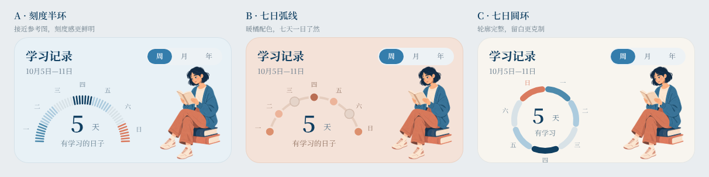

# 学习记录人物表盘调研与三案

2026-10-11。作者希望在前一轮柱状/圆环/圆点/折线探索之上，参考所提供的橘色半圆刻度＋右侧人物卡片，进一步改善观感。本轮仅绘制可审阅方案，未选定正式默认样式。

## 可借鉴的案例

| 来源 | 本轮观察与借鉴 | 在本项目中的处理 |
| --- | --- | --- |
| [Xeropan 官方课堂页](https://xeropan.com/classroom/)及其[官方界面插图](https://xeropan.com/images/bento-grid/b2c/section5.webp) | 人物、统计和行动入口组成同一张卡，插画让数值区更有亲和力 | 采用左侧统计、右侧阅读人物；沿用本项目海蓝/暖橘，而非复制角色或百分比 |
| [Apple Activity Rings](https://www.apple.com/watch/close-your-rings/) | 圆角端点、环形轮廓和颜色层级有辨识度；原产品的环与每日目标相连 | 只借鉴形状与层次；七段对应七个日期，不引入目标完成率 |
| [Finch 官方介绍](https://finchcare.com/about-finch) | 以角色陪伴形成温暖的产品观感 | 采用安静阅读的原创人物，不引入养成、奖励或打卡惩罚 |

以上是界面观察与设计建议，不据这些案例推断学习效果，也不将案例功能自动纳入Nautilus。

## 三版设计

- **A · 刻度半环**：浅海蓝底，49根细圆角刻度按七天分组，星期沿外侧排列。最接近作者参考图，也与当前蓝色按钮协调；本轮优先推荐继续细化这一版。
- **B · 七日弧线**：浅暖橘底，七个日期圆点沿弧线排列；视觉更轻松，刻度密度更低。
- **C · 七日圆环**：暖白底，七段圆角环，中央显示学习天数；轮廓完整、结构紧凑，但比A更像传统统计组件。

三版使用同一组纯示例活动数据`[2,1,0,3,1,0,2]`，汇总为5个有学习的日期。颜色深浅是可视化探索，不据此确认正式计数/强度规则；星期日沿用暖橘强调。没有连续填满的目标进度或掌握百分比。周/月/年入口保留外观，本轮三版为静态周视图，未复制原稿的跨板跳转。

卡片为372×216。整页均为412×915，从最新周主稿复制：本轮读取到其学习记录/今日/并排卡已较上次预览下移31px，原稿保持。新方案保留顶部y55，学习记录加高20px，下方两层相应下移20px，底部导航仍y831/h84。原周/月/年稿、旧四种图形探索和既有切换保留。

整页预览：[A](../superpowers/prototypes/home-material3/home-learning-records-dial-a-20261011.png) · [B](../superpowers/prototypes/home-material3/home-learning-records-dial-b-20261011.png) · [C](../superpowers/prototypes/home-material3/home-learning-records-dial-c-20261011.png)。

## 可编辑稿与素材

共享Penpot文件`New File 2`（`52a5041f-08a1-80f1-8008-c26eb9cfe134`），页面`首页 · Material 3`（`41874d1e-9f7d-8085-8008-c26f76ebe3f5`）。三案对照板`181e4f55-59e1-80b4-8008-c618e20d491e`位于x2404/y1650，1212×304；完整首页位于y2110：

| 方案 | 首页画板 | 学习记录卡片 |
| --- | --- | --- |
| A | `181e4f55-59e1-80b4-8008-c618dc75f1ec` | `181e4f55-59e1-80b4-8008-c618dc75f1f7` |
| B | `181e4f55-59e1-80b4-8008-c618de2f0f74` | `181e4f55-59e1-80b4-8008-c618de2f0f7f` |
| C | `181e4f55-59e1-80b4-8008-c618e01c50b0` | `181e4f55-59e1-80b4-8008-c618e01c50bb` |

图表、文字、卡片均为Penpot原生对象。仅人物使用一次内置`image_gen`生成，三个方案复用同一素材：[1024×1536透明PNG](../superpowers/prototypes/home-material3/assets/learning-reader-20261011.png)、[完整提示词](../superpowers/prototypes/home-material3/assets/learning-reader-20261011-prompt.txt)。原始alpha保留，未后处理位图；按108×162等比放置，人物朝向左侧统计区。未使用CLI生图。

已核对原周主稿编辑前后快照一致；Penpot结构校验0错误，三版静态稿交互数均0。对照板与三张完整首页均原生导出并目视检查；尺寸正确，三张首页底部84px与上一轮已保存导航RGB逐像素一致。未改业务代码、学习记录、数据库或试用服务。

下一项：作者比较三版，选定或提出组合偏好后继续细化；月/年对应图形和正式统计口径仍待确认。
